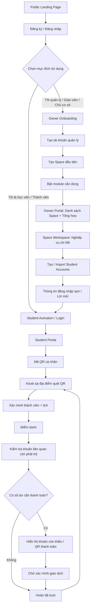

# TingRoster — System UI/UX & Portal Architecture

> **Tài liệu chuẩn để audit và refactor toàn hệ thống TingRoster.**
>
> Phiên bản: 1.0  
> Ngày: 30/10/2026  
> Phạm vi: Public website, đăng ký/đăng nhập, Owner/Teacher Portal, Space Portal, Student Portal, Kiosk Portal, Platform Admin, API, phân quyền, onboarding và design system.

---

## 0. Mục đích và thứ tự ưu tiên tài liệu

TingRoster hiện có nhiều màn hình và chức năng được phát triển qua nhiều đợt. Một số phần dùng chung một kiểu layout dù mục đích khác nhau; thuật ngữ chưa thống nhất; vai trò Owner/Teacher/Student/Kiosk chưa tách rõ; màn hình bên ngoài và bên trong không gian có nguy cơ bị trộn; các luồng học viên, QR, điểm danh và kiosk chưa được mô tả thành một hệ thống thống nhất.

Tài liệu này xác định lại **kiến trúc trải nghiệm sản phẩm**, không phải yêu cầu viết lại toàn bộ backend hay thay thế các nghiệp vụ đang chạy.

### 0.1. Tài liệu nào có quyền ưu tiên?

Khi các tài liệu cũ mâu thuẫn với tài liệu này, ưu tiên theo thứ tự:

1. Business logic, dữ liệu và ràng buộc bảo mật đang chạy trong repository — không được phá vỡ khi chưa có kế hoạch migration.
2. **`TINGROSTER_SYSTEM_UI_ARCHITECTURE.md` — tài liệu kiến trúc UI/portal chuẩn hiện tại.**
3. `AGENTS.md` và design system thực tế của repository, sau khi đã được cập nhật để khớp tài liệu này.
4. `TINGROSTER_MASTER_UI_UX_PROMPT.md` và `TINGROSTER_UI_UX_MASTER_PROMPT.md` — tài liệu tham khảo lịch sử. Chỉ tái sử dụng phần còn phù hợp; không làm theo các đoạn cũ nếu chúng khiến mọi vai trò dùng chung một dashboard, gộp báo cáo thành tab ngang hoặc mặc định sản phẩm chỉ có lớp học/phòng trọ.
5. Ảnh tham chiếu — chỉ là moodboard và định hướng thị giác, không phải đặc tả pixel-perfect hay bằng chứng rằng một tính năng đã tồn tại.

### 0.2. Quy trình bắt buộc trước khi sửa code

Agent phải:

1. Đọc tài liệu này và `AGENTS.md`.
2. Khảo sát repository: framework, apps, routes, layout, state management, API client, database schema, authentication, RBAC, storage, payment integration, QR scanner, kiosk và các scripts kiểm thử.
3. Lập bản đồ các route hiện tại theo portal/role. Không tự giả định tên route hoặc port đang được sử dụng.
4. Ghi rõ chức năng nào đã có backend, chức năng nào chỉ có UI, chức năng nào chưa tồn tại.
5. Chụp/kiểm tra các màn hình hiện tại nếu có browser tooling; ghi nhận vấn đề trước khi sửa.
6. Đề xuất migration theo từng phase; bảo toàn dữ liệu và backward compatibility khi có thể.
7. Chỉ sau đó mới triển khai. Không thay cả ứng dụng bằng mockup hoặc code mới không liên quan tới kiến trúc hiện có.

---

# 1. Định vị sản phẩm và mô hình tư duy

## 1.1. TingRoster là nền tảng quản lý nhiều không gian

TingRoster không phải phần mềm chỉ dành cho lớp học, câu lạc bộ hay nhà trọ. Người dùng tạo những **không gian quản lý (Space)** theo cách họ vận hành, đặt tên tùy ý và bật các module cần sử dụng.

Một tài khoản quản lý có thể có nhiều không gian, ví dụ:

- Lớp tiếng Anh buổi tối.
- Câu lạc bộ cầu lông.
- Cơ sở đào tạo Nguyễn Trãi.
- Khu căn hộ cho thuê.
- Nhóm hoạt động nội bộ.

Các ví dụ này không phải danh sách loại không gian cố định. Không hardcode toàn bộ sản phẩm theo các ví dụ trên.

Mỗi Space có:

- Tên riêng, mô tả, mã định danh duy nhất.
- Logo/avatar và màu nhận diện riêng.
- Owner, người quản lý, nhân sự và thành viên theo quyền.
- Danh sách module được bật.
- Dữ liệu, cấu hình, báo cáo, lịch sử và quy tắc nghiệp vụ riêng.
- Có thể có một hoặc nhiều địa điểm/kiosk nếu nghiệp vụ hỗ trợ.

### Phân biệt Space, Module và đối tượng nghiệp vụ

- **Space:** đơn vị quản lý cấp cao do người dùng tạo và đặt tên.
- **Module:** tính năng được bật trong một Space, ví dụ Thành viên, Lịch, Điểm danh, Khoản thu, Tin nhắn, Báo cáo.
- **Đối tượng nghiệp vụ:** dữ liệu cụ thể nằm trong module. Ví dụ trong module Giáo dục có lớp, khóa học, buổi học và học viên; trong module Thể thao có sân, lịch đặt, phiên chơi và người tham gia.

Không biến `Space` thành `Class`. Lớp học chỉ là một đối tượng thuộc module Giáo dục, không phải mô hình bắt buộc cho mọi Space.

## 1.2. Hai cấp quản lý khác nhau

Đây là quy tắc kiến trúc UI quan trọng nhất:

**Cấp ngoài — Quản lý nhiều không gian:** xem danh sách Space, tạo Space, chỉnh sửa thông tin cơ bản, bật/tắt module và xem thống kê tổng hợp có thể so sánh giữa các Space.

**Cấp trong — Làm việc tại một không gian:** có sidebar, dashboard, chức năng, báo cáo và dữ liệu chi tiết của đúng Space đang mở.

Không sao chép dashboard bên trong ra ngoài. Không đưa mọi báo cáo của mọi Space vào một màn hình ngoài cùng. Không biến trang ngoài thành một trang nghiệp vụ khổng lồ.

## 1.3. Nguyên tắc phân tách trải nghiệm

TingRoster cần các portal/shell riêng cho:

1. Public Website — khách chưa đăng nhập.
2. Owner/Teacher Portal — người quản lý tài khoản và nhiều Space.
3. Space Workspace — nghiệp vụ chi tiết của một Space cụ thể; có thể là một route area trong Owner Portal hoặc app shell riêng tùy repository.
4. Student Portal — học viên/thành viên chỉ xem dữ liệu của chính mình và thao tác được cấp.
5. Kiosk Portal — thiết bị tự phục vụ tại sân/cơ sở; không phải Student Portal và không phải Admin Portal.
6. Platform Admin Portal — đội vận hành TingRoster.

Mỗi portal có navigation, route guard, quyền, API contract và UI shell riêng. Chúng có thể chia sẻ design tokens, thư viện UI và domain services, nhưng không dùng một sidebar/dashboard cho tất cả.

---

# 2. Bản đồ portal, vai trò và quyền

## 2.1. Role model

Không dùng một trường role toàn cục để mô tả mọi tư cách trong hệ thống. Cần phân biệt quyền toàn nền tảng và vai trò trong từng Space.

| Nhóm quyền | Phạm vi | Mục đích |
|---|---|---|
| `platform_admin` | Toàn nền tảng | Vận hành TingRoster, hỗ trợ, kiểm soát hệ thống và xử lý yêu cầu được cấp quyền |
| `space_owner` | Một Space | Chủ sở hữu, quản lý cấu hình, thành viên, module và gói dịch vụ theo quyền |
| `space_manager` | Một Space | Quản lý các nghiệp vụ được Owner cấp |
| `teacher` / `staff` | Một Space | Thực hiện công việc chuyên môn hoặc vận hành được giao |
| `student` | Tư cách thành viên | Chỉ dùng Student Portal, xem thông tin của mình và thao tác được phép |
| `kiosk_device` | Một thiết bị/địa điểm/Space | Quyền máy, chỉ gọi API kiosk được cấp, không phải user tương tác bình thường |
| `parent_guardian` (nếu triển khai) | Quan hệ với học viên cụ thể | Xem thông tin học viên được liên kết và được cho phép |

Các role trong bảng là định hướng. Trước khi thay enum/schema hiện có, phải ánh xạ với role và permission thực tế trong repository.

### Quy tắc quan trọng

- `platform_admin` không đồng nghĩa với Owner của một Space.
- Owner của Space A không tự có quyền tại Space B.
- Teacher không mặc định có quyền xem doanh thu, billing hoặc cài đặt nhạy cảm của Owner.
- Student không có quyền truy cập màn hình Owner, Admin, quản lý Space hoặc dữ liệu của học viên khác.
- Kiosk device không được dùng tài khoản Owner/Student để đăng nhập như một người dùng thông thường.
- Ẩn menu ở frontend không đủ để bảo mật; backend phải kiểm tra role, membership, permission và scope của từng request.

## 2.2. Một tài khoản có thể có nhiều tư cách

Một người có thể là Owner/Teacher ở Space này và là Student/Member ở Space khác. Vì vậy:

- Tài khoản đăng nhập là identity.
- Tư cách/role trong Space là membership hoặc assignment riêng.
- Màn hình mặc định sau login dựa trên portal và quyền hợp lệ.
- Nếu tài khoản có nhiều tư cách, chỉ hiển thị lựa chọn chuyển portal/Space mà tài khoản thực sự có quyền.
- Tài khoản học viên được giáo viên cấp theo chế độ Student-only không được tự nâng quyền bằng cách sửa URL hoặc gửi request khác.
- Việc đăng ký chọn “Tôi quản lý” hay “Tôi là học viên” chỉ là bước khởi tạo luồng onboarding; không phải cơ chế tự cấp quyền. Quyền thực tế đến từ server.

## 2.3. Portal và route boundary

Tên route ví dụ dưới đây là đề xuất logic. Agent phải kiểm tra route hiện tại trước khi đổi và có thể ánh xạ sang convention sẵn có.

| Portal | Route base tham khảo | Shell riêng | Truy cập |
|---|---|---|---|
| Public | `/` và `/auth/*` | Public layout | Không cần đăng nhập |
| Owner | `/owner/*` | Owner shell | Owner/Manager/Teacher theo permission |
| Space | `/owner/spaces/:spaceId/*` | Space shell | Thành viên có quyền trong Space đó |
| Student | `/student/*` | Student shell | Student/Guardian theo quyền |
| Kiosk | `/kiosk/*` | Full-screen kiosk shell | Kiosk device/session hợp lệ |
| Platform Admin | `/platform-admin/*` | Admin shell | Platform Admin có quyền tương ứng |

Có thể dùng subdomain riêng khi kiến trúc deployment hỗ trợ, ví dụ `app`, `student`, `kiosk`, `admin`; không bắt buộc tạo các server/port riêng chỉ vì role khác nhau.

**Lưu ý về port:** TCP port hoặc URL khác nhau không tự tạo ra bảo mật. Điều quan trọng là route guard, middleware, API authorization, token scope, device identity và tenant isolation ở backend. Tách deployment nếu có lợi cho release/performance/security boundary, không tách chỉ để làm cho có vẻ độc lập.

---

# 3. Sơ đồ tổng quan trải nghiệm

Sơ đồ là mô hình trải nghiệm mục tiêu. Các nhánh phải được ánh xạ vào API và rule thật trong repository; không được giả lập để khớp sơ đồ.

---

# 4. Public Website và đăng ký

## 4.1. Landing page công khai

Landing page nói rõ TingRoster là nền tảng quản lý nhiều không gian, không chỉ lớp học/phòng trọ.

Cấu trúc gợi ý:

1. Hero: giá trị cốt lõi và product preview thật.
2. Vấn đề vận hành TingRoster giải quyết.
3. Module cốt lõi: thành viên, lịch/hoạt động, điểm danh, khoản thu, đối soát, báo cáo.
4. Sử dụng trên nhiều thiết bị: desktop, tablet, điện thoại, kiosk.
5. Mô hình sử dụng minh họa theo ngành, nhưng không giới hạn hệ thống vào các ví dụ đó.
6. Cách bắt đầu: tạo Space → bật module → mời/tạo thành viên → vận hành.
7. Gói dịch vụ, dùng thử và câu hỏi thường gặp — nội dung phải khớp billing backend.
8. Chính sách, hỗ trợ và footer.

### Motion

- AOS: hiệu ứng xuất hiện theo section, dùng tiết chế.
- GSAP: hero/product showcase hoặc một số timeline cần kiểm soát.
- Lenis: smooth scrolling trên landing page nếu không ảnh hưởng keyboard, anchor và accessibility.
- GSAP ScrollTrigger phải đồng bộ đúng với Lenis nếu dùng.
- Tôn trọng `prefers-reduced-motion`.
- Không dùng AOS/GSAP/Lenis trong kiosk; Student QR cũng không cần animation trang trí.
- Landing page phải hiển thị đầy đủ nội dung ngay cả khi animation không chạy.

### SEO public

- Title, meta description, canonical, Open Graph, sitemap, robots, semantic headings và alt text riêng từng trang.
- Không index Student Portal, Owner Portal, Kiosk, Admin, dữ liệu cá nhân hoặc route yêu cầu đăng nhập.
- Không tạo structured data về giá, review, công ty, địa chỉ hay cam kết nếu chưa có nguồn xác nhận.
- Không tạo các landing page gần như giống nhau chỉ để nhắm nhiều từ khóa.

## 4.2. Đăng ký: chọn chế độ sử dụng

Màn hình đăng ký cần có hai lựa chọn rõ ràng:

**A. Tôi quản lý / Tôi là giáo viên / Chủ cơ sở**

Dành cho người muốn tạo và quản lý Space. Sau khi đăng ký, họ đi vào Owner Onboarding, tạo Space và bật module.

**B. Tôi là học viên / Thành viên**

Dành cho người đã được giáo viên/chủ không gian tạo tài khoản hoặc gửi lời mời. Họ nhập thông tin đăng nhập hoặc mã kích hoạt/lời mời hợp lệ để kích hoạt tài khoản.

Không cho học viên tự tạo membership vào Space chỉ bằng cách chọn Student trên form. Không cho một tài khoản tự cấp quyền Teacher/Owner.

### Luồng Student chưa có lời mời

Nếu chọn chế độ học viên nhưng chưa có tài khoản/mã mời:

- Hướng dẫn liên hệ giáo viên/đơn vị quản lý để được cấp tài khoản.
- Có thể hỗ trợ đăng nhập nếu đã có tài khoản.
- Không tự tạo hồ sơ Student trống hoặc tự tham gia Space bất kỳ.
- Không hiện nút tạo Space, dùng thử Pro hoặc cài đặt Owner.

## 4.3. Dùng thử Pro 30 ngày

- Tài khoản đăng ký theo luồng quản lý/giáo viên/chủ cơ sở được cấp quyền dùng thử Pro 30 ngày theo chính sách sản phẩm.
- Trial gắn với owner/account hoặc billing entity được xác định ở backend, không gắn với từng Space để tránh tạo nhiều Space nhằm reset trial.
- Bắt đầu trial theo một mốc thống nhất, đề xuất sau khi tài khoản quản lý hoàn tất xác minh và tạo Space đầu tiên; nếu billing policy hiện tại quy định khác, phải ghi rõ và giữ một nguồn sự thật.
- Student không được nhận trial Pro và không thấy UI upgrade dành cho Owner.
- Không tự động thu tiền khi hết hạn nếu chưa có consent và payment mandate hợp lệ.
- Khi trial kết thúc, hiển thị rõ quyền lợi mất đi, dữ liệu được bảo toàn và cách nâng cấp. Không xóa dữ liệu hoặc khóa truy cập đột ngột nếu policy chưa quy định.
- Không cho tạo tài khoản mới/Space khác để tự động nhận thêm trial nếu điều khoản hạn chế đã được thiết lập.

---

# 5. Owner Portal — quản lý nhiều không gian

Đây là màn hình ngoài cùng sau khi người quản lý đăng nhập. Nó không phải dashboard chi tiết của một Space.

## 5.1. Trang “Không gian của tôi”

Nội dung chính:

- Header: tiêu đề “Không gian của tôi”, mô tả ngắn, nút “Tạo không gian”.
- Danh sách Space: logo/avatar, tên, mã, trạng thái và một vài chỉ số phù hợp với module đang bật.
- Search/filter/sort theo tên, trạng thái hoặc tiêu chí thực sự có dữ liệu.
- Menu More trên từng Space: mở, chỉnh sửa thông tin, quản lý tính năng, lưu trữ/xóa nếu được phép.
- Thao tác chỉnh logo và màu nhận diện nằm trong form “Thông tin không gian”, không rải thành các nút riêng lẻ ngoài danh sách.

## 5.2. Dashboard tổng hợp ngoài cùng

Chỉ có chỉ số tổng quan ở mức nhiều Space, ví dụ:

- Số Space đang hoạt động.
- Số thành viên duy nhất hoặc tổng lượt tham gia — phải ghi rõ đang đo gì.
- Hoạt động phát sinh trong kỳ.
- Chỉ số khoản thu có thể tổng hợp giữa các Space và cùng định nghĩa.
- Space cần chú ý nếu backend thực sự có cảnh báo tương ứng.

Không gom tất cả báo cáo chi tiết của từng Space lên trang này. Không cộng sai số người, số tiền hoặc giao dịch giữa các Space. Nếu nhiều Space dùng định nghĩa khác nhau, không hiển thị một con số tổng gây hiểu nhầm.

## 5.3. Menu Owner Portal

Giữ tối giản, ví dụ:

- Tổng quan.
- Không gian của tôi.
- Dùng thử / Gói dịch vụ / Thanh toán TingRoster.
- Hồ sơ cá nhân.
- Trợ giúp.

Các mục có thể thay đổi theo sản phẩm thực tế. Không đưa Thành viên, Điểm danh, Khoản thu, Báo cáo chi tiết vào đây nếu chúng thuộc một Space cụ thể.

---

# 6. Space Workspace — bên trong một không gian

Khi mở một Space, người dùng chuyển sang một app shell/ngữ cảnh khác. Header, sidebar, màu nhận diện, dashboard, data scope và quyền đều lấy theo Space đang mở.

## 6.1. Header và điều hướng

Header thể hiện:

- Avatar/logo và tên Space.
- Breadcrumb và tiêu đề trang.
- Tìm kiếm trong phạm vi Space nếu có.
- Thông báo/trợ giúp theo quyền.
- Hồ sơ tài khoản.

Không lặp lại chức năng đổi ngôn ngữ, đổi theme hoặc đăng xuất ở nhiều vị trí. Chức năng toàn cục có một vị trí chính.

Sidebar có nhóm và submenu. Không dùng hàng tab ngang để gom các tính năng/báo cáo.

## 6.2. Mẫu sidebar theo module

Menu phải được tạo từ module đang bật và permission của người dùng. Ví dụ:

**Tổng quan**
- Bảng điều khiển.

**Quản lý**
- Thành viên.
- Nhóm/đơn vị con (nếu bật).
- Lịch và hoạt động (nếu bật).

**Điểm danh**
- Điểm danh.
- Lịch sử điểm danh.
- Thiết bị/Kiosk (nếu có quyền quản lý).

**Tài chính**
- Khoản thu.
- Khoản phải thu.
- Giao dịch.
- Đối soát.

**Báo cáo**
- Tổng quan báo cáo.
- Báo cáo khoản thu.
- Báo cáo công nợ.
- Báo cáo hoạt động.
- Báo cáo điểm danh.
- Báo cáo giao dịch/đối soát.

**Giao tiếp**
- Thông báo.
- Tin nhắn (nếu module/entitlement cho phép).

**Tự động hóa**
- Quy tắc.
- Lịch sử thực thi (nếu có).

**Quản lý không gian**
- Thông tin không gian.
- Tính năng sử dụng.
- Thành viên quản trị và quyền.
- Cấu hình thanh toán của đơn vị nhận tiền nếu được cấp quyền.

Không hiển thị menu không có chức năng thật. Không dùng tên “Cài đặt và logo”; dùng tên mô tả đúng mục đích như “Thông tin không gian”, “Tính năng sử dụng”, “Thành viên quản trị và quyền”.

## 6.3. Báo cáo là route riêng

Mỗi báo cáo có URL, page title, filter, chart, số liệu và bảng chi tiết riêng. Không dùng tab ngang để đổi giữa các báo cáo.

Bên trong Space mới có báo cáo chi tiết theo nghiệp vụ. Trang ngoài chỉ tổng hợp một số chỉ số nhiều Space.

Mỗi báo cáo:

1. Tiêu đề và mô tả.
2. Bộ lọc từ ngày đến ngày và các tiêu chí phù hợp.
3. KPI có công thức rõ.
4. Biểu đồ phù hợp câu hỏi phân tích.
5. Bảng chi tiết đối chiếu được.
6. Pagination/server-side query.
7. Export nếu được triển khai và đúng quyền.

---

# 7. Giáo dục: module và trải nghiệm riêng

Không dùng `Space` đồng nghĩa `Lớp học`. Một Space có thể bật module Giáo dục; bên trong module mới có các đối tượng giáo dục.

## 7.1. Cấu trúc nghiệp vụ giáo dục tham khảo

Tùy hệ thống hiện có, có thể gồm:

- Chương trình/khóa học.
- Lớp học hoặc nhóm học.
- Buổi học/lịch học.
- Giáo viên/phụ trách.
- Học viên.
- Enrollment/quan hệ học viên với lớp.
- Điểm danh theo buổi.
- Khoản thu/học phí.
- Tài liệu/thông báo/tin nhắn nếu module hỗ trợ.

Không buộc mọi trường phải có nếu dữ liệu và nghiệp vụ hiện tại chưa cần. Không nhầm lớp với Space.

## 7.2. Giáo viên/Owner quản lý học viên

Trong Space Giáo dục, giáo viên hoặc Owner có thể:

- Tạo một tài khoản Student nhanh bằng form.
- Tạo nhiều tài khoản bằng Excel import.
- Thêm học viên đã có tài khoản vào lớp/nhóm đúng quyền.
- Gán học viên vào một hoặc nhiều lớp nếu schema hỗ trợ.
- Gửi lời mời hoặc cấp thông tin kích hoạt/đăng nhập tạm.
- Gỡ học viên khỏi lớp mà không xóa tài khoản và lịch sử đã phát sinh.
- Xem trạng thái kích hoạt tài khoản và lời mời.

### Form tạo nhanh

Các trường phải dựa trên schema thật. Có thể gồm tên, email/điện thoại/username, mã học viên nội bộ, lớp được gán và thông tin liên hệ cần thiết. Không thu thập trường không cần thiết.

### Import Excel

Luồng bắt buộc:

1. Tải file mẫu Excel có cấu trúc và ví dụ.
2. Upload file.
3. Map cột nếu cần.
4. Preview dữ liệu.
5. Validate trường bắt buộc, email/số điện thoại, mã trùng và lớp được gán.
6. Hiển thị lỗi theo từng dòng; cho tải báo cáo lỗi.
7. Xác nhận import.
8. Backend tạo batch và xử lý idempotent.
9. Trả kết quả thành công/thất bại và tài khoản cần kích hoạt.

Không ghi đè tài khoản hiện tại nếu chưa có quy tắc và xác nhận rõ. Không import mật khẩu plaintext do người dùng tự đưa vào Excel.

### Cấp thông tin đăng nhập cho học viên

- Hệ thống tạo username/mã đăng nhập và mật khẩu tạm hoặc activation code bảo mật.
- Mật khẩu phải được sinh bằng cơ chế an toàn, lưu dưới dạng hash; không lưu plaintext.
- Có thể cung cấp kết quả một lần qua màn hình hoặc file tải xuống được kiểm soát để giáo viên chuyển cho học viên.
- Bắt buộc đổi mật khẩu hoặc thiết lập mật khẩu cá nhân ở lần đăng nhập đầu tiên.
- Không cho phép giáo viên xem lại mật khẩu sau khi kết quả ban đầu đã được đóng.
- Có thể gửi email/SMS nếu tích hợp thật và được cấu hình.
- Không đưa mật khẩu vào log, báo cáo import lâu dài hoặc trường database không mã hóa.

Student được tạo theo luồng này phải nhận đúng quyền Student, không phải Owner hoặc Teacher.

---

# 8. Student Portal — giao diện dành riêng cho học viên/thành viên

Student Portal phải là trải nghiệm độc lập, không phải Owner Portal bị ẩn một vài menu.

## 8.1. Shell và navigation

Mobile-first, đơn giản và dễ dùng. Các mục gợi ý:

- Trang chủ.
- Lịch của tôi / Lớp của tôi.
- Mã QR của tôi.
- Khoản phí / Thanh toán.
- Tin nhắn / Thông báo nếu được bật.
- Tài khoản.

Desktop có sidebar hoặc navigation gọn theo thiết kế riêng. Mobile có bottom navigation 4–5 mục quan trọng; không ép nhiều chức năng ngang nhau.

Không hiển thị:

- Quản lý Space.
- Tạo lớp.
- Quản lý học viên khác.
- Import Excel.
- Báo cáo quản trị.
- Cài đặt Owner.
- Subscription/Trial Pro dành cho Owner.

## 8.2. Trang chủ học viên

Chỉ hiển thị dữ liệu của học viên đang đăng nhập:

- Lịch/hoạt động sắp tới.
- Lớp hoặc nhóm đang tham gia.
- Trạng thái điểm danh gần đây.
- Khoản phí còn phải trả của chính mình.
- Thông báo và lời mời.
- Liên kết nhanh tới mã QR cá nhân.

Không hiển thị dữ liệu học viên khác hoặc tổng tài chính của cả lớp.

## 8.3. Màn hình “Mã QR của tôi”

Đây là nơi học viên mở QR trên điện thoại để đưa cho kiosk quét.

Yêu cầu:

- QR đủ lớn và có độ sáng/nền phù hợp để camera kiosk đọc nhanh.
- Hiển thị tên và avatar của chính học viên cùng mã thành viên dễ nhận diện.
- Có trạng thái mã đang hoạt động/hết hạn/đang làm mới.
- Ưu tiên token QR ngắn hạn, có chữ ký hoặc cơ chế xác minh server; không nhúng thông tin cá nhân, số dư hoặc mật khẩu vào QR.
- Có hướng dẫn “Đưa mã này trước camera tại điểm check-in”.
- Có refresh token an toàn nếu QR hết hạn.
- Không dùng animation trang trí.
- Nếu tài khoản chưa được kích hoạt hoặc chưa được gán vào Space/lớp, không cấp QR có thể check-in. Hiển thị hướng dẫn liên hệ giáo viên/đơn vị quản lý.

**Phân biệt rõ:** Student Portal hiển thị QR cá nhân. Kiosk Portal là nơi mở camera/scanner để đọc QR đó. Không đảo ngược hai giao diện này.

## 8.4. Học viên chưa đăng ký/chưa được mời

- Không tự tạo tài khoản Student có membership mở.
- Không tự tham gia lớp hoặc Space chỉ bằng mã lớp công khai.
- Chỉ kích hoạt tài khoản khi có lời mời/credential hợp lệ từ Owner/Teacher hoặc luồng đã được chủ Space cho phép.
- Khi chưa có tài khoản, trang Student mode giải thích cách nhận tài khoản.
- Khi đã có tài khoản nhưng chưa được gán lớp/Space, hiển thị trạng thái chờ được liên kết; không hiện QR check-in hợp lệ.

---

# 9. Kiosk Portal — thiết bị check-in tại sân/cơ sở

Kiosk là thiết bị tự phục vụ, không phải Student Portal, cũng không phải màn hình quản trị. Kiosk cần tự nhận diện thiết bị và Space/địa điểm được gán.

## 9.1. Hai loại màn hình QR khác nhau

1. Student QR screen: học viên mở mã cá nhân trên điện thoại.
2. Kiosk scanner screen: tablet/PC tại địa điểm mở camera hoặc nhận scanner USB/Bluetooth để quét mã học viên.

Không tạo một trang kiosk cho học viên mở QR và gọi đó là màn kiosk.

## 9.2. Kiosk chưa cấu hình và người chưa đăng ký

Phân biệt hai trường hợp:

- **Thiết bị kiosk chưa được kích hoạt/cấu hình:** hiển thị màn hình setup có hướng dẫn cho quản trị viên, không cho người lạ vào chế độ vận hành.
- **Mã học viên không hợp lệ/chưa được đăng ký:** hiển thị thông báo ngắn, không tiết lộ hồ sơ người khác; hướng dẫn liên hệ quầy/giáo viên.

Kiosk không tự tạo tài khoản học viên hoặc tự thêm người vào lớp.

## 9.3. Màn hình chờ quét

- Logo/tên Space, sân/cơ sở và vị trí kiosk.
- Ngày giờ hiện tại.
- Trạng thái camera/scanner và kết nối.
- Vùng quét QR lớn; scanner tự khởi động khi chế độ vận hành đã sẵn sàng.
- Hướng dẫn ngắn: mở “Mã QR của tôi” trên điện thoại và đưa mã trước camera.
- Nhập mã thủ công là phương án dự phòng nếu được cấu hình.
- Không có sidebar hoặc dashboard Owner.
- Không có animation trang trí.

## 9.4. Luồng check-in

1. Kiosk đọc QR.
2. Backend xác minh token, tài khoản, membership và đúng Space/kiosk.
3. Tìm lịch/booking/buổi hoạt động phù hợp theo thời điểm và địa điểm.
4. Nếu có đúng một lựa chọn hợp lệ, tự chọn.
5. Nếu nhiều lịch hợp lệ, yêu cầu người dùng chọn một cách đơn giản.
6. Kiểm tra điều kiện thời gian, trạng thái và việc đã check-in hay chưa.
7. Ghi điểm danh bằng API.
8. Chỉ thông báo thành công sau khi backend xác nhận.
9. Kiểm tra khoản công nợ liên quan theo rule của Space.
10. Hiển thị trạng thái công nợ hoặc phương án thanh toán nếu cần.
11. Xóa thông tin người vừa dùng và quay lại màn sẵn sàng.

## 9.5. Kiểm tra công nợ và thanh toán

Kiosk chỉ truy vấn khoản phải thu có liên quan đến lịch/hoạt động hoặc rule của Space. Không mặc định lấy toàn bộ khoản nợ của thành viên để chặn họ.

Hiển thị các tình trạng:

- Không còn phải trả.
- Có khoản chưa thanh toán.
- Đã thanh toán một phần.
- Có giao dịch đang xác minh.
- Chưa thể xác minh do lỗi kết nối.

Nếu còn tiền phải trả:

- Hiển thị nội dung, tổng tiền, số đã trả, số còn lại.
- Hiển thị nút thanh toán và QR/phương thức thật nếu cấu hình hỗ trợ.
- Cho “Để sau” nếu policy cho phép.
- Nếu bắt buộc thanh toán trước khi tham gia, hiển thị lý do và rule cụ thể.
- Không cho client tự đặt `PAID`.
- Không xác nhận đã chuyển khoản chỉ dựa trên lời khai của người dùng.
- Nếu giao dịch pending, tiếp tục kiểm tra giao dịch hiện tại; không tạo yêu cầu thanh toán trùng.

Điểm danh và thanh toán là hai trạng thái độc lập. Thanh toán thất bại không tự động xóa điểm danh đã được backend chấp nhận. Rule có được tham gia tiếp hay không phải do Space cấu hình và backend áp dụng.

## 9.6. Thiết bị và thao tác

- Hỗ trợ camera tablet/PC và scanner QR USB/Bluetooth hoạt động như keyboard wedge nếu phù hợp.
- Không bắt người dùng bấm vào input mỗi lần nếu scanner tự gửi chuỗi mã.
- Chống đọc trùng liên tiếp; khóa xử lý trong lúc request đang chạy.
- Xử lý camera permission, HTTPS, camera không tồn tại, mất mạng, timeout, QR lỗi và mã hết hạn.
- Có âm thanh báo thành công/lỗi nếu chủ Space bật và thiết bị hỗ trợ; không phụ thuộc âm thanh để truyền trạng thái.
- Bảo vệ khỏi điều hướng vô tình và truy cập trái phép vào dashboard.
- Có timeout tự trở về trạng thái sẵn sàng sau kết quả, nhưng không tự ẩn màn hình đang cần người dùng xử lý lỗi/thanh toán.
- Không lưu hồ sơ hay số dư của người vừa check-in trên màn hình sau khi phiên kết thúc.

---

# 10. Design System — chuẩn hóa toàn bộ UI

Tài liệu cũ có mô tả một số token và style, nhưng các vấn đề thực tế đang gặp yêu cầu tinh chỉnh lại. Không máy móc áp dụng font đậm, radius lớn hoặc card giống nhau trên mọi màn hình.

## 10.1. Visual direction

- Premium productivity SaaS, rõ ràng, tinh tế và thực dụng.
- Nền trung tính, surface sạch, màu thương hiệu có kiểm soát.
- Bố cục theo thứ bậc dọc; không nhồi filter, title, action và KPI vào một hàng.
- Không có gradient phủ khắp ứng dụng.
- Không lạm dụng card, border, shadow hoặc pill shape.
- Không làm tất cả component tròn trịa như mobile toy app.
- Form, table, chart, kiosk, landing page và student portal có bố cục riêng phù hợp mục đích.

## 10.2. Typography nhẹ và thoáng

Người dùng phản ánh kiểu chữ hiện tại quá đậm, cao và dính nhau. Hãy audit font đang tải và toàn bộ typography tokens.

Hướng dẫn:

- Ưu tiên Be Vietnam Pro hoặc font tiếng Việt hiện có nếu tải đúng.
- Body thường dùng 14–15px desktop, line-height khoảng 1.5–1.65; mobile điều chỉnh theo nội dung.
- Label/metadata có thể nhỏ hơn nhưng không giảm đến mức khó đọc.
- Page title không mặc định phải cực lớn hoặc bold nặng.
- Dùng regular/medium cho phần lớn nội dung; semibold cho điểm nhấn; bold chỉ cho thông tin thực sự cần nhấn.
- Tránh `font-bold` hàng loạt.
- Kiểm tra font weight thực sự có trong file font; không giả định browser tạo ra weight tốt.
- Có wrap hợp lý, không ép chữ một dòng nếu nội dung dài.
- Dùng tabular numerals cho dữ liệu số/tiền.

## 10.3. Spacing và layout

- Hệ spacing nhất quán theo bội số 4px.
- Có khoảng cách phân biệt heading, helper text, filter, table, chart và section.
- Nội dung dài có max-width hợp lý.
- Không để form field, bảng và toolbar chạm sát nhau.
- Trên mobile, ưu tiên dọc; không cuộn ngang toàn trang.
- Không giảm font toàn cục để xử lý overflow; xử lý lại bố cục trước.

## 10.4. Màu và theme

- Có token cho text primary/secondary, canvas, surface, semantic status, accent, hover, active, selected, focus và disabled.
- Light/dark mode phải được kiểm tra ở tất cả portal.
- Logo trắng không được biến mất trên nền sáng: dùng asset light/dark đúng hoặc nền phù hợp.
- Logo ngân hàng và logo thương hiệu theo yêu cầu phải hiển thị trên nền trắng kể cả dark mode; bỏ padding thừa quanh asset nhưng không bóp méo logo.
- Hover card/chart không được đổi nền thành trắng một cách máy móc. Hover chỉ thay đổi tonal value phù hợp với surface/theme hiện tại.
- Icon quan trọng cần nền và glyph có độ tương phản cao; không dựa riêng vào border mảnh.
- Màu nhận diện từng Space được lưu riêng và áp dụng trong phạm vi Space; không ghi đè semantic status success/warning/error.
- Màu gói dịch vụ thuộc design system toàn cục và giữ nhất quán giữa landing page, màn chọn gói và billing.

## 10.5. Shape, radius và shadow

- Không bo tròn mọi thứ thành pill.
- Input/button có radius vừa phải; table, panel, dialog và navigation dùng radius theo ngữ cảnh.
- Không dùng shadow lớn để tạo chiều sâu giả.
- Dùng nền, spacing và hierarchy để nhóm nội dung trước; border chỉ dùng khi cần phân tách.

## 10.6. Hover/focus/selected/loading

Mỗi component cần đúng state theo ngữ cảnh:

- Hover không phá nền của card/chart.
- Focus phải nhìn thấy bằng keyboard.
- Selected không chỉ dựa vào màu nếu có thể gây nhầm.
- Disabled khác loading.
- Loading không làm mất dữ liệu cũ một cách không cần thiết.
- Empty/error state phải nêu việc tiếp theo có thể làm.

## 10.7. Logo và avatar

- Logo Space đổi trong form “Thông tin không gian”, không rải nút đổi logo ở ngoài danh sách.
- Avatar cá nhân đổi trong “Hồ sơ cá nhân”.
- Logo nhóm/lớp đổi ở form chỉnh sửa đối tượng tương ứng.
- Logo ngân hàng dùng asset rõ, nền trắng, không padding thừa.
- Fallback Space: logo đã tải → icon module được chọn → chữ viết tắt tên → icon mặc định.
- Không dùng avatar người sở hữu thay cho logo Space nếu chưa có rule.

---

# 11. API và kiến trúc backend tách theo portal/domain

Tách API theo domain và mục đích của portal, nhưng không nhân bản business logic. Frontend có thể khác shell, route và API namespace; backend vẫn dùng chung domain services và data model có kiểm soát.

## 11.1. API namespace tham khảo

Đây là target structure tham khảo, không được tạo route trùng với API hiện có khi chưa audit.

| Namespace | Mục đích | Quyền chính |
|---|---|---|
| `/api/v1/auth/*` | Đăng ký, đăng nhập, activation, reset password, session | Public/authenticated theo endpoint |
| `/api/v1/owner/*` | Quản lý tài khoản và danh sách Space, trial/subscription của Owner | Owner/Manager theo quyền |
| `/api/v1/spaces/:spaceId/*` | Nghiệp vụ chi tiết của một Space | Membership + permission đúng Space |
| `/api/v1/student/me/*` | Hồ sơ, lớp, lịch, QR, điểm danh, khoản phải trả của chính user | Student/Guardian scope |
| `/api/v1/kiosk/*` | Thiết bị, identify QR, tìm session, check-in, outstanding summary, payment status | Kiosk device token/scope |
| `/api/v1/platform-admin/*` | Quản trị toàn nền tảng, ticket, user, subscription, audit | Platform Admin permission |

Có thể dùng resource routes khác nếu REST convention của repository đã rõ. Điều quan trọng là scope quyền và response contract riêng, không phải đúng nguyên văn URL ví dụ.

## 11.2. API tách chuẩn nhưng domain logic dùng chung

- Student API chỉ trả dữ liệu của tài khoản đang đăng nhập. Không nhận `studentId` tùy ý để đọc hồ sơ người khác nếu endpoint không có quyền đặc biệt.
- Kiosk API chỉ xử lý Space/địa điểm đã gắn với device identity.
- Space API phải kiểm tra membership và permission server-side.
- Owner API chỉ trả Space mà Owner được phép quản lý.
- Platform Admin API có audit và quyền riêng.
- Không tin `role`, `spaceId`, `isAdmin`, `isPaid` do frontend tự gửi.
- Tách DTO/serializer theo portal để tránh Student nhận field nội bộ của Owner.
- Shared domain services dùng chung quy tắc điểm danh, khoản thu, payment và membership; không copy/paste business rules thành nhiều phiên bản.
- API phải có versioning, validation, consistent error shape, pagination và idempotency cho mutation phù hợp.

## 11.3. Model dữ liệu logic cần kiểm tra

Không tạo hết các bảng bên dưới một cách máy móc. Dùng để kiểm tra schema hiện có và xác định các quan hệ bị thiếu:

- User / Identity.
- UserProfile.
- Space.
- SpaceMembership / SpaceRole / Permission.
- SpaceModuleSetting.
- SpaceAsset / logo reference.
- Class / Course / Group (chỉ thuộc module tương ứng).
- StudentProfile hoặc StudentMembership nếu cần tách domain.
- Enrollment.
- Session / Schedule / Booking.
- AttendanceRecord.
- Invitation / ActivationCredential.
- StudentImportBatch / ImportRowResult.
- KioskDevice / KioskLocation / DeviceToken.
- QRToken hoặc cơ chế token ngắn hạn có thể revoke/verify.
- Charge / ChargeLine / Payment / PaymentAllocation / ReconciliationRecord.
- Plan / Subscription / TrialEntitlement.
- AuditLog.

Cần đảm bảo một user có thể là thành viên của nhiều Space và có thể giữ các vai trò khác nhau theo ngữ cảnh, nếu nghiệp vụ cho phép.

## 11.4. Import và tạo học viên

Gợi ý API flow:

1. Download template.
2. Upload import batch.
3. Preview/validate.
4. Commit batch.
5. Poll/get batch result.
6. One-time retrieval of activation details if applicable.

Backend phải chống duplicate, xử lý partial success, ghi lỗi từng dòng và giới hạn kích thước/số dòng. Không tạo account trùng do retry. Không trả lại mật khẩu plaintext ở các lần đọc batch sau.

## 11.5. QR và kiosk

- QR nên chứa opaque token/signed reference ngắn hạn, không chứa password, số dư hoặc PII nhạy cảm.
- Server kiểm tra token, thời hạn, trạng thái, đúng Space/kiosk và điều kiện check-in.
- Check-in phải idempotent hoặc được bảo vệ bởi unique constraint phù hợp.
- Kiosk không thể sửa kết quả bằng client payload.
- Khi payment pending, kiosk query trạng thái hiện có; không tạo payment request mới mỗi lần retry.

## 11.6. Thanh toán và queue

- Tách tiền dịch vụ TingRoster khỏi khoản thu của Space.
- Không để TingRoster giữ tiền người dùng trong mô hình chưa được thẩm định và cấp phép phù hợp.
- Verify payment/webhook phía server, idempotency key, unique provider transaction ID, audit.
- Queue/worker chỉ sử dụng khi có tác vụ nền thực sự cần: webhook processing, reconciliation, email, imports, report aggregation.
- Worker idempotent, retry có backoff, dead-letter hoặc failed-job queue, monitoring.
- Cân nhắc transactional outbox khi cần bảo đảm publish event sau DB commit.
- Database rollback khác với compensation/refund ở nhà cung cấp thanh toán.

---

# 12. Gói dịch vụ và entitlement

## 12.1. Phân biệt Owner billing và khoản thu Space

- Owner billing: khoản Owner trả cho TingRoster.
- Space receivables: khoản Space thu từ Student/Member.

Hai ledger, báo cáo, quyền xem và API không được gộp.

## 12.2. Màu gói dịch vụ

Các gói Starter/Pro/Business/Enterprise (nếu tên này khớp catalog thật) có màu nhận diện nhất quán trên landing, chọn gói, subscription và dialog nâng cấp.

- Gói hiện tại, gói đang chọn và gói được đề xuất phải có trạng thái khác nhau.
- Không chỉ dùng border để thể hiện selected.
- Không tự tạo giá/quyền lợi chỉ để làm card đẹp.
- Student không thấy CTA nâng cấp Pro của Owner.

## 12.3. Entitlement

Một chức năng chỉ khả dụng nếu:

1. Module đã bật trong Space.
2. Plan/trial có entitlement.
3. User có permission.
4. Backend xác nhận trạng thái hợp lệ.

Frontend chỉ dùng để trình bày. Backend là nguồn quyết định cuối cùng.

---

# 13. Báo cáo, danh sách và hiệu năng

- Không dùng tab ngang để gom nhiều báo cáo.
- Mỗi báo cáo là route/submenu riêng bên trong Space.
- Báo cáo có filter từ ngày đến ngày và tiêu chí phù hợp với dữ liệu.
- Biểu đồ lấy dữ liệu thật, có thể đối chiếu với bảng chi tiết.
- KPI và chart phải đồng bộ với filter.
- Bảng lớn sử dụng server-side pagination hoặc cursor pagination.
- Infinite loading chỉ dùng cho danh sách phù hợp; virtual scrolling giảm DOM nhưng không thay thế API pagination.
- Tin nhắn/lịch sử dài cần cursor, deduplicate, giữ scroll position và xử lý reconnect.
- Filter đổi phải hủy/bỏ qua response cũ, reset cursor/page phù hợp.
- Có skeleton, loading, empty, error, retry và background refetch rõ ràng.
- Không hardcode chart data hoặc số liệu demo trong production.

---

# 14. Naming system — ngôn ngữ giao diện

Tên mục phải diễn đạt mục đích, tự nhiên và đúng ngữ cảnh. Không ghép hai khái niệm không cùng cấp vào một tiêu đề.

| Không nên dùng | Nên dùng |
|---|---|
| Cài đặt và logo | Thông tin không gian |
| Lớp học/Phòng trọ mặc định ở mọi nơi | Không gian / Đơn vị quản lý (tùy ngữ cảnh) |
| Quản lý dữ liệu | Tên cụ thể của đối tượng đang quản lý |
| Báo cáo chung chứa tất cả tab | Báo cáo khoản thu / Báo cáo điểm danh / Báo cáo đối soát |
| Share Zalo / Share Facebook rải nhiều nút | Chia sẻ (mở lựa chọn có logo Zalo/Facebook khi hỗ trợ) |
| Thêm user | Thêm thành viên / Tạo tài khoản học viên — đúng theo hành động |
| Xóa user khỏi lớp | Gỡ học viên khỏi lớp (không xóa tài khoản) |
| Paid | Đã thanh toán — chỉ khi backend xác nhận |
| QR lỗi | Mã không hợp lệ / Mã hết hạn / Không có quyền check-in — nêu lý do phù hợp |

Quy tắc:

- Tiếng Việt tự nhiên, nhất quán.
- Không trộn từ Anh/Việt nếu không cần.
- Dùng “thành viên” cho khái niệm chung; dùng “học viên” trong module Giáo dục; dùng “người chơi/thành viên” trong module Thể thao khi đúng nghiệp vụ.
- Dùng “Không gian” cho Space cấp cao; không gọi Space là lớp học.
- Breadcrumb, page title, sidebar, modal, button, tooltip và empty state phải dùng cùng thuật ngữ.

---

# 15. Bản đồ màn hình cần có

| Màn hình | Portal | Mục đích | Không được hiển thị |
|---|---|---|---|
| Landing | Public | Giới thiệu sản phẩm, pricing, CTA | Dữ liệu cá nhân/dashboard thật |
| Đăng ký chọn chế độ | Public/Auth | Chọn Owner/Manager hoặc Student activation | Cấp quyền tự động không xác minh |
| Owner Home | Owner | Danh sách Space và thống kê tổng hợp | Báo cáo chi tiết của từng Space |
| Tạo/Chỉnh Space | Owner | Tên, mô tả, logo, màu, module | Các nút chỉnh logo lẻ tẻ ngoài danh sách |
| Space Dashboard | Space | Tình hình một Space | Số liệu Space khác |
| Space Members | Space | Thành viên và quyền | Tài khoản ngoài Space nếu không được phép |
| Giáo dục — Classes/Sessions | Space/Education | Lớp, buổi học, lịch | Tự coi Space là lớp |
| Student Import | Space/Education | Tạo tài khoản Student nhanh/hàng loạt | Mật khẩu plaintext lưu lâu dài |
| Space Billing | Space | Khoản thu của Space | Billing của TingRoster |
| Space Reports | Space | Báo cáo riêng từng nghiệp vụ | Tab ngang gom mọi báo cáo |
| Student Home | Student | Lịch, lớp, thông báo, khoản của mình | Owner controls, admin reports |
| Student QR | Student | QR cá nhân để kiosk đọc | QR có PII/số dư/mật khẩu |
| Student Activation | Student/Auth | Kích hoạt bằng lời mời/credential | Tự tham gia Space không được phép |
| Kiosk Ready | Kiosk | Scanner luôn sẵn sàng | Sidebar Owner, dashboard, edit data |
| Kiosk Result | Kiosk | Kết quả check-in/công nợ | Thông tin người dùng trước đó |
| Kiosk Unconfigured | Kiosk | Setup thiết bị có kiểm soát | Mở vận hành vô danh |
| Platform Admin | Admin | Quản trị nền tảng | Quyền tự nâng từ client |

---

# 16. Responsive, accessibility và trạng thái

Kiểm tra tối thiểu:

- Mobile: 390×844 và 430×932.
- Tablet: 768×1024.
- Desktop: 1280×800 và 1440×900.
- Kiosk: các tỷ lệ màn hình thực tế tìm được trong cấu hình triển khai.

Yêu cầu:

- Mobile Student Portal ưu tiên thao tác một tay và bottom navigation gọn.
- Owner/Space mobile dùng drawer hoặc layout điều hướng thích hợp; không giữ sidebar desktop thu nhỏ một cách khó dùng.
- Bảng mobile dùng card hoặc cuộn ngang trong container nếu cần; không làm cả trang tràn ngang.
- Mọi input, button, switch, select có label, focus và vùng chạm phù hợp.
- Đủ contrast; không dùng màu là tín hiệu duy nhất.
- Tôn trọng `prefers-reduced-motion`.
- Kiosk không có animation trang trí.
- Có initial loading, refetch, mutation, empty, error, retry, success và offline/unavailable state đúng nơi.

---

# 17. Kế hoạch triển khai theo phase

Không refactor đồng loạt mọi route cùng lúc. Làm theo các phase có đầu ra kiểm chứng được.

## Phase A — Repository & UI Audit

Đầu ra:
- Route map theo portal.
- Role/permission map.
- API map và data source map.
- Danh sách UI đang dùng sai shell.
- Danh sách mock/static data và tính năng chỉ có UI.
- Danh sách route/label/tab cần đổi.
- Screenshot và issue log khi tooling cho phép.

## Phase B — Design System & Naming

- Font, weight, line-height, spacing.
- Color tokens, light/dark, hover/focus.
- Logo/Avatar rules.
- Button/input/select/switch/table/dialog/toast.
- Responsive primitives.
- Quy tắc naming tiếng Việt.

## Phase C — Portal separation

- Public/Auth layout.
- Owner shell và trang Không gian của tôi.
- Space shell và submenu theo module.
- Student shell.
- Kiosk shell.
- Platform Admin shell.
- Route guards, role-aware landing và navigation fallback.

## Phase D — Registration, onboarding & Pro trial

- Chọn chế độ Owner/Teacher hoặc Student.
- Owner onboarding và tạo Space.
- Bật module.
- Cấp Pro trial 30 ngày theo policy.
- Student invitation/activation.

## Phase E — Education student account lifecycle

- Tạo tài khoản Student nhanh.
- Import Excel, template, preview, validation, batch result.
- Cấp credential/activation an toàn.
- Gán lớp/enrollment.
- Student Portal và Student QR.

## Phase F — Kiosk workflow

- Kiosk device provisioning.
- Auto scanner.
- Identify QR.
- Resolve session/booking.
- Attendance.
- Outstanding balance.
- Payment flow nếu có integration.
- Reset session/PII.

## Phase G — Space modules, reports & performance

- Tách route báo cáo.
- Data thật, API filters, charts, pagination.
- Virtual scroll/infinite loading cho nơi phù hợp.
- Import/export và audit.

## Phase H — Platform Admin, legal, SEO & QA

- Admin role/ticket/trial/subscription/audit.
- Điều khoản, privacy, billing/refund pages dựa trên thông tin đã xác minh.
- SEO public.
- Accessibility, responsive, performance, tests/build.

Sau mỗi phase, báo cáo file đã sửa, tính năng thật đã hoạt động, API/schema mới, test đã chạy và phần còn thiếu. Không ghi “done” cho phần mới chỉ dựng UI.

---

# 18. Acceptance criteria — điều kiện hoàn thành

## Kiến trúc và portal

- [ ] Trang ngoài chỉ quản lý nhiều Space và thống kê tổng hợp.
- [ ] Mở Space chuyển sang shell và sidebar riêng.
- [ ] Báo cáo và chức năng chi tiết là route riêng trong Space, không gom tab ngang.
- [ ] Student Portal không dùng Owner shell.
- [ ] Kiosk không dùng Student hoặc Admin shell.
- [ ] Platform Admin có route guard và permission riêng.

## Tài khoản và giáo dục

- [ ] Đăng ký có lựa chọn Owner/Teacher và Student activation.
- [ ] Student không thể tự cấp role hoặc tự tham gia Space không được mời.
- [ ] Owner/Teacher đủ điều kiện nhận Pro trial 30 ngày theo rule server.
- [ ] Student không thấy billing/trial Owner.
- [ ] Giáo viên tạo tài khoản học viên nhanh được.
- [ ] Import Excel có template, preview, validate, batch result và chống tạo trùng.
- [ ] Credential tạm không lưu plaintext và yêu cầu đổi/activate an toàn.
- [ ] Học viên chỉ thấy dữ liệu của mình trong Student Portal.

## QR và kiosk

- [ ] Student có màn hình QR cá nhân riêng.
- [ ] Kiosk tự scan QR từ điện thoại và có fallback nhập mã/scanner ngoài.
- [ ] Backend xác minh mã, membership, lịch/booking và địa điểm.
- [ ] Check-in không tạo trùng.
- [ ] Kiosk kiểm tra công nợ liên quan, không lấy số dư giả.
- [ ] Thanh toán chỉ xác nhận khi provider/bank/backend xác thực.
- [ ] Kiosk không để lộ dữ liệu của lượt trước.
- [ ] Không có animation trang trí trong kiosk.

## UI/UX

- [ ] Typography bớt nặng, có line-height và khoảng thở.
- [ ] Light/dark, logo và hover không bị sai.
- [ ] Không bo tròn tất cả component.
- [ ] Tên menu/tiêu đề dễ hiểu và nhất quán.
- [ ] Mobile không tràn ngang ngoài ý muốn.
- [ ] Loading, empty, error và success state đúng.

## API/security

- [ ] API namespace theo domain/portal, nhưng business rules không bị duplicate.
- [ ] Backend enforce role, membership, space scope và device scope.
- [ ] API Student chỉ trả dữ liệu self/authorized relation.
- [ ] API Kiosk chỉ dùng device token có scope.
- [ ] Mutations nhạy cảm có idempotency/audit phù hợp.
- [ ] Không có hardcoded secrets hoặc mock payment state ở production.

---

# 19. Prompt khởi chạy cho Antigravity/Codex

Đọc toàn bộ `TINGROSTER_SYSTEM_UI_ARCHITECTURE.md`, `AGENTS.md` và các tài liệu project liên quan trước khi sửa code.

Bắt đầu bằng repository audit. Hãy lập route map, role map, API map và xác định các điểm đang trộn lẫn Owner, Space, Student, Kiosk và Admin. Đối chiếu với database và backend thực tế; không tự suy đoán API, framework, port hoặc khả năng thanh toán.

Sau audit, triển khai từng phase theo tài liệu. Ưu tiên trước:

1. Tách rõ màn ngoài “Không gian của tôi” và màn trong từng Space.
2. Tách Owner Portal, Student Portal và Kiosk Portal thành shell/route/permission riêng.
3. Chỉnh đăng ký chọn chế độ quản lý hoặc học viên; student activation dựa trên lời mời/tài khoản được cấp.
4. Xây luồng tạo tài khoản học viên nhanh/import Excel và Student Portal/QR cá nhân.
5. Hoàn thiện kiosk auto-scan → identify → resolve session → attendance → outstanding check → payment if needed.
6. Chuẩn hóa API namespace/DTO/authorization theo portal, dùng chung domain services và dữ liệu đúng scope.

Không tạo thêm một app/port chỉ để phân biệt role nếu route guard và app shell hiện tại giải quyết được. Nếu quyết định tách deployment/subdomain, phải nêu lý do, auth/cookie/CORS strategy và ranh giới bảo mật.

Không chỉ viết kế hoạch. Hãy chỉnh sửa code, chạy ứng dụng, kiểm tra screenshot/browser khi tooling cho phép, chạy lint/typecheck/tests/build. Không bịa data, không tạo button giả, không báo thanh toán/điểm danh thành công trước server. Ghi rõ điều gì đã implement, điều gì chưa có backend và điều gì cần quyết định sản phẩm.

---

# 20. File tham chiếu hiện có

Các tài liệu/ảnh sau được cung cấp để tham khảo lịch sử thiết kế:

- `TINGROSTER_MASTER_UI_UX_PROMPT.md`
- `TINGROSTER_UI_UX_MASTER_PROMPT.md`
- `a_clean_high_resolution_collage_board_image_of_a.png`
- `a_large_high_resolution_ui_ux_design_presentation.png`
- `a_high_resolution_dark_themed_ui_ux_showcase_coll.png`
- `a_wide_clean_modern_ui_ux_product_presentation_p.png`
- `a_clean_minimal_vector_style_logo_branding_image.png`

Ảnh collage giúp định hướng visual, không thay cho UI thật. Những điểm cần sửa so với các prompt cũ:

- Không coi mọi thứ là một workspace/class duy nhất.
- Không cho Owner, Student, Kiosk và Platform Admin dùng chung shell.
- Không dùng một dashboard tổng hợp làm nơi chứa mọi nghiệp vụ.
- Không dùng tab ngang để gom các báo cáo.
- Không hiển thị menu theo loại lớp học/phòng trọ cố định; menu phải theo module và permission.
- Không để học viên tự thêm mình vào Space nếu chưa có lời mời hoặc policy cho phép.
- Không nhầm Student QR screen với Kiosk scanner screen.
- Không dùng kiosk như một phiên bản thu nhỏ của web học viên.

**Kết luận sản phẩm:** TingRoster là nền tảng đa không gian. Owner quản lý danh sách Space và tổng quan ở cấp ngoài; mỗi Space có bộ module, dữ liệu, dashboard và báo cáo riêng; giáo viên tạo/quản lý tài khoản học viên; học viên dùng một portal giới hạn cho chính họ; kiosk là thiết bị tự phục vụ độc lập để quét QR, xác minh, điểm danh và kiểm tra khoản còn phải trả. Các portal có UI và quyền riêng, nhưng chia sẻ domain services và dữ liệu thông qua API được phân quyền chặt chẽ.
