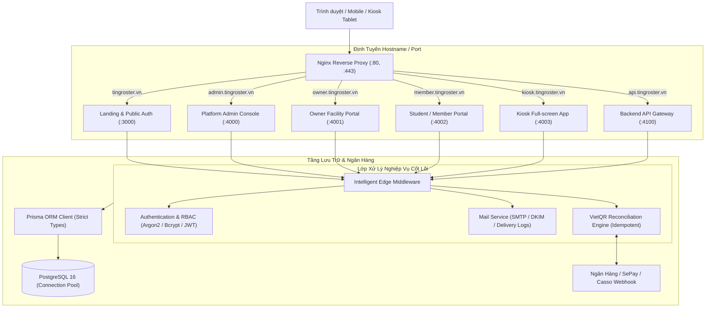

# TingRoster Enterprise System Architecture

Tài liệu kiến trúc kỹ thuật toàn diện của nền tảng TingRoster: Mô hình dữ liệu, phân định tài chính, kiến trúc mạng đa cổng và quy chuẩn thiết kế.

---

## 1. Tầm Nhìn Kiến Trúc (Architecture Overview)

TingRoster được kiến trúc theo mô hình **Domain-Driven Modular SaaS** với các lớp phân định rõ ràng:

---

## 2. Nguyên Tắc Phân Định Tài Chính Bất Biến (Financial Boundary Invariant)

Hệ thống tuân thủ nghiêm ngặt nguyên lý **Zero-Custody** (Không chiếm dụng vốn):

- **Miền A — Platform Credits (Ví dịch vụ TingRoster):**
  - Là tiền nạp của Chủ cơ sở vào tài khoản TingRoster để trả cước duy trì hệ thống (500đ/giao dịch đối soát, cước ZNS thông báo).
  - Được quản lý thông qua bảng `User.serviceBalance` và `AuditLog`.
- **Miền B — Customer Collections (Dòng tiền thu học phí / tiền thuê):**
  - 100% tiền học phí, tiền phòng trọ, tiền sân bãi chảy **trực tiếp** từ tài khoản ngân hàng của học sinh/hội viên sang Số tài khoản ngân hàng cá nhân của Chủ cơ sở thông qua mã động VietQR.
  - TingRoster **tuyệt đối không giữ tiền, không mở tài khoản trung gian, không gộp 2 dòng tiền này**.

---

## 3. Kiến Trúc Bảo Mật & Idempotency

1. **Lũy đẳng thanh toán (Idempotency):**
   - Webhook nhận giao dịch được bảo vệ bằng ràng buộc unique `[provider, providerTransactionId]`.
   - Mọi khoản cộng tiền vào hóa đơn đều được bọc trong giao dịch nguyên tử `prisma.$transaction`.
2. **Kiểm tra phân quyền hai đầu (Dual Authorization):**
   - Không dựa vào việc ẩn nút trên giao diện. Mọi endpoint API đều xác thực `userId`, so sánh quyền sở hữu cơ sở và kiểm tra vai trò tại backend.
3. **Phòng chống dò quét (Anti-Enumeration):**
   - Phản hồi trung tính cho các yêu cầu quên mật khẩu và đăng nhập thất bại.
4. **Mật khẩu an toàn:**
   - Sử dụng thuật toán băm với salt 10 rounds, không trả về password hash trong bất kỳ API response nào.
