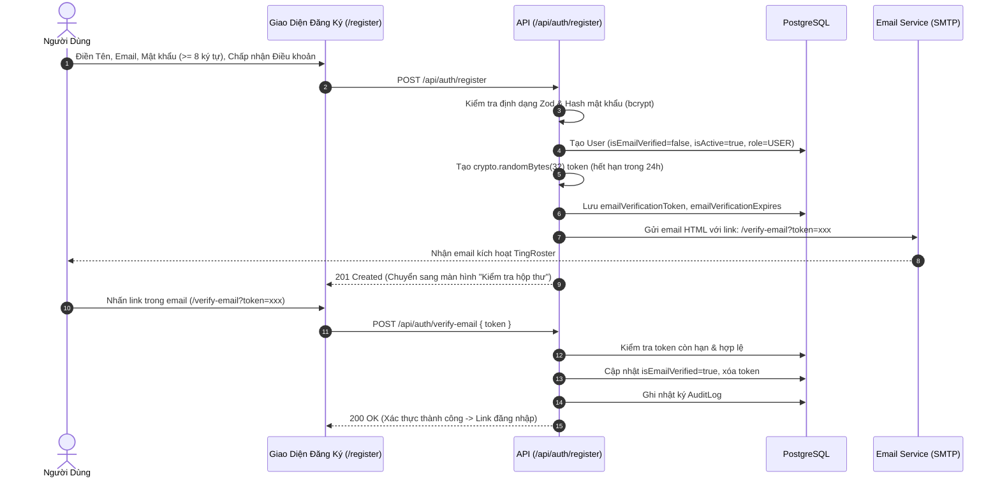

# TingRoster Authentication & Identity Architecture

Tài liệu chi tiết về hệ thống xác thực người dùng thực, luồng xác thực qua email, quản lý phiên và bảo mật tài khoản.

---

## 1. Nguyên Tắc Cốt Lõi

1. **Zero Mock Accounts:** Tuyệt đối loại bỏ mọi tài khoản demo (`demo@tingroster.vn`), nút "Login as Demo" và cơ chế auto-login.
2. **Email Verification Bắt Buộc:** Người dùng đăng ký bắt buộc phải xác nhận email qua mã token bảo mật ngẫu nhiên (32 bytes entropy) có thời hạn 24 giờ trước khi được cấp quyền sử dụng đầy đủ.
3. **Session Bảo Mật:** Sử dụng JWT ký bằng `JWT_SECRET` với thuật ngữ rõ ràng (`HS256`), lưu trữ trong HttpOnly Cookie (`tingroster_session`), cấm lưu trữ token nhạy cảm trong `localStorage`.
4. **Anti-Enumeration Protection:** Các API quên mật khẩu và đăng nhập không làm lộ thông tin email có tồn tại trên hệ thống hay không.
5. **No Plaintext Passwords:** Không lưu trữ, không trả về frontend và không hiển thị mật khẩu người dùng cho bất kỳ ai, kể cả Platform Admin.

---

## 2. Quy Trình Đăng Ký & Xác Thực Email



---

## 3. Quy Trình Khôi Phục Mật Khẩu (Forgot & Reset Password)

1. **Yêu cầu khôi phục:** Người dùng nhập email tại `/forgot-password`.
2. **Bảo vệ quyền riêng tư:** API trả về thông báo trung tính `"Nếu email tồn tại trong hệ thống, hướng dẫn đặt lại mật khẩu đã được gửi"`, không làm lộ sự tồn tại của tài khoản.
3. **Mã Token một lần (One-Time Token):** Token có hiệu lực trong 60 phút.
4. **Đặt lại mật khẩu:** Người dùng mở `/reset-password?token=xxx`, nhập mật khẩu mới. Token cũ bị hủy ngay lập tức sau khi cập nhật thành công, và hệ thống gửi email cảnh báo bảo mật tới hộp thư của người dùng.

---

## 4. Bảng Phân Quyền Vai Trò (Role-Based Access Control)

| Vai Trò (Role) | Phạm Vi Quyền Hạn | Cổng Mặc Định |
| :--- | :--- | :--- |
| `SUPER_ADMIN` | Quản trị toàn bộ hạ tầng, xem audit log, mở/khóa tài khoản, nạp ví dịch vụ | `4000` (`/admin`) |
| `ADMIN` | Quản trị vận hành hệ thống, hỗ trợ người dùng | `4000` (`/admin`) |
| `OWNER` | Chủ cơ sở: Tạo lớp học/phòng trọ, cấu hình VietQR, đối soát giao dịch | `4001` (`/dashboard`) |
| `MANAGER` | Quản lý được phân quyền trong phạm vi cơ sở cụ thể | `4001` (`/dashboard`) |
| `STAFF` | Nhân viên vận hành: Điểm danh, kiểm tra danh sách thành viên | `4001` (`/dashboard`) |
| `MEMBER` / `USER` | Học sinh, hội viên, người thuê phòng: Xem công nợ cá nhân, quét mã QR | `4002` (`/portal`) |

---

## 5. Quy Trình Khởi Tạo Super Admin Đầu Tiên (Bootstrap)

Hệ thống **không có mật khẩu admin mặc định** và **không seed tài khoản admin mẫu**.
Để tạo tài khoản Super Admin đầu tiên an toàn trên môi trường máy chủ:

```bash
# Chạy script bootstrap chính thức
npx tsx scripts/bootstrap-admin.ts
```

Script sẽ yêu cầu nhập:
- Email quản trị viên (ví dụ: `admin@tingroster.vn`)
- Tên đầy đủ
- Mật khẩu bảo mật (tối thiểu 8 ký tự)

Sau khi tạo thành công, script sẽ tự động ghi log vào bảng `AuditLog` và kích hoạt ngay trạng thái `isEmailVerified=true`, `role=SUPER_ADMIN`.
